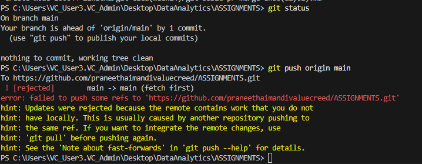
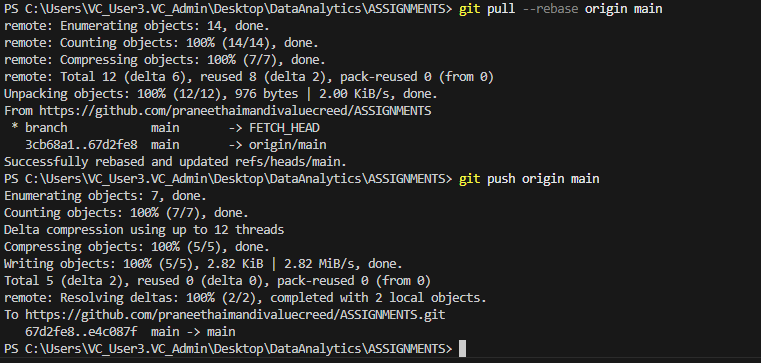

# Git and CI/CD – Running Notes

## 1. Git Basics

**Git:** Git is a version control system used to track changes in code. It helps developers work together and maintain different versions of a project.

**Important Git Commands:**

- `git clone` – Downloads an existing repository from GitHub to our local system.
- `git branch` – Creates or lists branches.
- `git switch` – Switches from one branch to another.
- `git add .` – Adds modified files to the staging area.
- `git commit` – Saves changes in Git history with a message.
- `git push` – Uploads local commits to GitHub.
- `git pull` – Gets the latest changes from GitHub and integrates them into the local branch.
- `git merge` – Combines changes from one branch into another.

**Some important terms:**

- Repository – A project managed using Git.
- Branch – A separate working area to develop new features.
- Commit – A saved checkpoint of code changes.
- Pull Request (PR) – A request to merge our changes into another branch.

## 2. Feature Branch Workflow

Feature branch workflow is a way of working where developers create separate branches for their tasks instead of directly modifying the main branch.

**Workflow:**

1. Clone the repository.
2. Pull the latest changes.
3. Create a new feature branch.
4. Make the required code changes.
5. Stage and commit the changes.
6. Push the branch to GitHub.
7. Create a Pull Request.
8. Get the code reviewed and approved.
9. Merge the changes into the main branch.

**Good Pull Request should contain:**

- Clear title and description.
- What changes were made and why.
- Testing details.
- Screenshots if required.

## 3. Merge Conflicts and Undo Commands

**Merge Conflict:** Occurs when Git cannot automatically combine changes, usually when two developers modify the same part of a file. We need to manually resolve the conflict.

**Commands used to undo mistakes:**

- `git revert` – Reverses a previous commit by creating a new commit.
- `git reset` – Moves the branch to an earlier commit.
- `git stash` – Temporarily saves uncommitted changes so we can work on something else.

Note: `git reset --hard` can permanently remove uncommitted changes, so use it carefully.

## 4. Repository Management

A repository should contain files required to understand, run and maintain the project.

**Files to include:**

- Python files (.py)
- README.md
- requirements.txt
- Test files
- Configuration files

**Files that should not be uploaded:**

- API keys and passwords
- .env files
- Large raw datasets
- Temporary files
- Database files (when not required)
- **pycache** folders

**.gitignore:** A file used to tell Git which files should not be tracked or uploaded to the repository.

Example:

```gitignore
.env
__pycache__/
*.pyc
*.duckdb
*.parquet
```

Important: Never upload sensitive information like API keys, passwords and database credentials to GitHub.

## 5. Introduction to CI/CD

**CI/CD:** A practice used to automate software development tasks like building, testing and deploying code. It reduces manual work and helps find errors early.

### CI – Continuous Integration

- Developers frequently push their code changes to a shared repository.
- Whenever changes are pushed or a Pull Request is created, automated checks can run.
- Helps identify errors before merging code.

**Common CI activities:**

1. Installing dependencies.
2. Checking code syntax.
3. Checking code quality.
4. Running automated tests.
5. Reporting test results.

### CD – Continuous Delivery / Continuous Deployment

CD is the next step after CI. It deals with preparing and releasing tested code.

**Continuous Delivery:**

- Code is automatically tested and prepared for deployment.
- Manual approval is usually required before production deployment.

**Continuous Deployment:**

- Code is automatically deployed to production after passing the required checks.
- No manual approval is needed for each release.

**Difference:**

- CI focuses on integrating and testing code.
- CD focuses on preparing and deploying code.

## 6. Development Environments

Different environments are maintained to develop, test and run applications safely.

- **DEV (Development):** Used by developers to write, modify and experiment with code.
- **TEST (Testing):** Used to check whether the code works correctly before deployment.
- **PROD (Production):** Actual live environment where the application or pipeline is used.

Example:

- DEV – Developing a new ETL transformation.
- TEST – Checking the transformation output.
- PROD – Running the approved ETL pipeline with actual business data.

## 7. Basic CI/CD Workflow

1. Developer writes or modifies code.
2. Code is pushed to GitHub.
3. CI pipeline starts automatically.
4. Dependencies are installed and tests are executed.
5. If tests fail, errors need to be fixed.
6. If tests pass, the code moves towards deployment.
7. CD prepares or deploys the code to the required environment.

## 8. CI/CD Tools

Some commonly used CI/CD tools:

- **GitHub Actions:** 
- **Jenkins:**
- **Azure DevOps:**
- **GitLab CI/CD:**


## 9. Common Git Problems

- **Rejected push:** Happens when the remote repository has changes that are not available in our local branch. Usually resolved by pulling and integrating the latest changes.
- **Merge conflict:** Happens when Git cannot automatically combine changes. Needs manual resolution.
- **Accidentally committed a secret:** Immediately revoke or rotate the exposed secret, remove it from the repository and clean it from Git history if required. Deleting it in a new commit alone is not enough.

**Final understanding:**

Git is used to track and manage code changes. GitHub is used to host repositories and collaborate with other developers. CI automatically checks and tests code, while CD prepares and deploys the tested code into the required environment.
**REJECTED PUSH HANDLING**

- A push may get rejected if the remote branch has changes that are not present in my local branch.
- First, check the current branch and status using git status.
- Pull the latest remote changes using git pull --rebase origin <branch-name>.
- If merge conflicts occur, resolve them, then run git add . and git rebase --continue.
- After resolving everything, push again using git push origin <branch-name>.
- Avoid git push --force because it can overwrite other people's changes.




